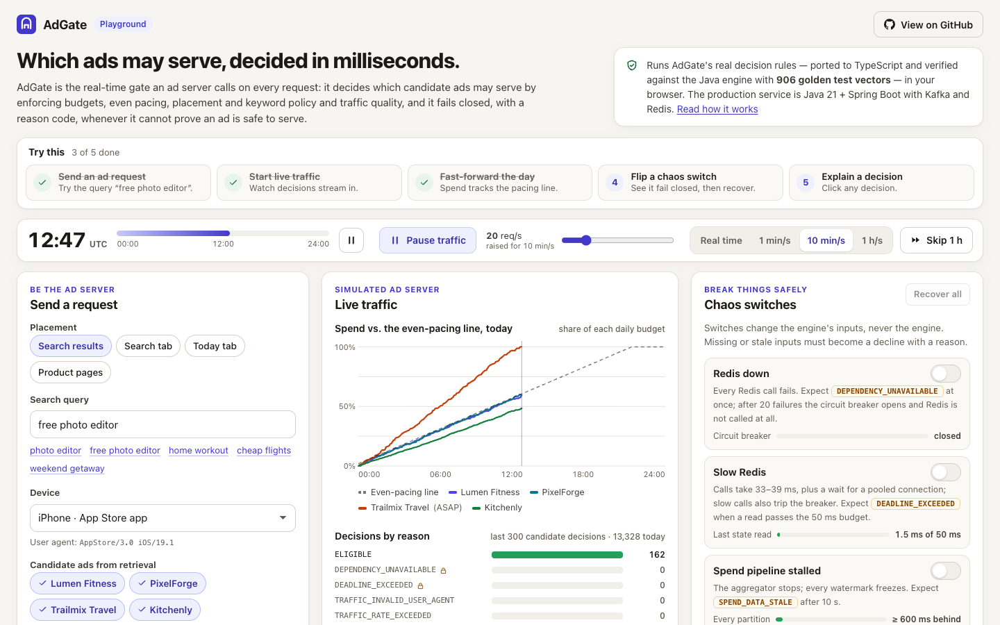
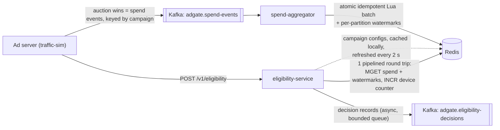

# AdGate

[](https://github.com/gargshishirr/adgate/actions/workflows/ci.yml)

**Real-time ad eligibility, budget pacing and fail-closed serving decisions.**
Java 21 · Spring Boot 3.5 · Kafka · Redis · Resilience4j · Micrometer/Prometheus

**New here? Read the short [GUIDE.md](GUIDE.md)**: how to run it, keep it safe and maintain it.

AdGate is the gate an ad server calls inline for every ad request. Given the candidates that retrieval produced, it
decides in a few milliseconds which ones may serve, and why the others may not. It enforces daily budgets and even
pacing from a near-real-time spend pipeline, applies placement and negative-keyword policy, and filters invalid
traffic. It **fails closed**: if any signal it depends on is missing, stale or unreachable, it declines to serve and
returns a structured reason code that flows into downstream analytics.

## Try it in your browser

**[gargshishirr.github.io/adgate](https://gargshishirr.github.io/adgate/)**: no Java, Kafka or Redis needed. Send ad
requests, watch live traffic hold even-paced campaigns on their pacing line, flip chaos switches (Redis down, spend
pipeline stalled, stale config) to see AdGate fail closed, and click any decision to see the exact snapshot and every
rule the engine checked.

[](https://gargshishirr.github.io/adgate/)

The playground runs AdGate's real decision rules, ported to TypeScript in [`playground/`](playground). A Java test
(`GoldenVectorsTest`) runs the real engine, sampler, query normalizer, pacing math and partitioner over more than 900
golden vectors and checks them against `playground/src/engine/golden.json`; the playground's tests must reproduce
every one exactly, detail strings included, so the two cannot drift apart. Redis, Kafka, the spend aggregator, the
circuit breaker and the traffic are small simulations around the ported engine.

## Highlights

- **Fail closed, with a reason.** Every input carries its own freshness. Anything missing, stale or unreachable becomes
  a decline with a specific reason code, never an optimistic serve.
- **Provable spend freshness.** Per-partition low watermarks show how current the spend data is. A stalled Kafka
  partition fails closed only the campaigns it carries.
- **Effectively-once spend accounting.** At-least-once Kafka delivery feeds an atomic, idempotent Redis Lua ledger.
- **One round trip on the hot path.** One pipelined Redis call returns an atomic snapshot of spend and watermarks, plus
  the device's traffic counter.
- **Deterministic, replayable decisions.** The engine is a pure function of (request, state snapshot), so any recent
  decision can be explained and replayed exactly.
- **Resilience built in.** Timeouts, a circuit breaker, bounded reconnect backoff, warm-up gated by readiness, and
  analytics publishing that never blocks serving.
- **Runs anywhere.** A Docker-free local mode (in-process Kafka and Redis with a chaos switch), plus a Docker Compose
  stack with Prometheus and Grafana.
- **Safe by default.** API keys (separate admin and client keys, rotatable), strict input validation, loopback-only
  ports, metrics on a separate local port, and a `prod` profile that refuses to start with weak keys.

## Results (measured on a laptop, local mode)

These come from closed-loop simulations at 150 requests/s with 3 candidates per request. Auction wins are fed back as
spend. Kafka, Redis and all services ran on one machine; the in-process Redis is slower than real Redis.

| What was measured | Result |
|---|---|
| Steady-state latency, client side including HTTP | p50 ≈ 2.5–3.5 ms, p99 ≈ 5–10 ms |
| Requests that errored, out of 13,498 including two injected failures | 0 |
| Redis taken down for 6 s | 97% of decisions failed closed at p50 2.2 ms (circuit open); breaker closed again ~1 s after Redis returned |
| Spend aggregator killed | Campaigns failed closed with `SPEND_DATA_STALE` once spend was 10 s old; after restart, lag was back under 1 s within seconds |
| Spend accounting through a 21 s Redis outage | 495 of 495 charges applied exactly once; 11 of 11 deliberately duplicated events rejected |
| Decision records published to Kafka | 15,749 of 15,749 (0 dropped, 0 failed) |
| Even-paced campaigns | Held at their pacing line (≈ 52% of budget at 11:00 UTC) |

## Architecture



| Module | Role |
|---|---|
| `adgate-common` | Spend event schema, Redis key layout, and a Kafka-compatible partition function |
| `eligibility-service` | Inline decisions, explain and replay tooling, campaign admin API |
| `spend-aggregator` | Kafka → Redis spend ledger and freshness watermarks |
| `traffic-sim` | Closed-loop load generator: ad requests in, auction wins out as spend events |
| `local-infra` | Docker-free Kafka and Redis in one JVM, with a Redis chaos switch |

## How a decision is made

1. **Read state.** Campaign configs come from a local cache that refreshes in the background. Spend counters, the
   watermarks of the partitions that carry those campaigns, and the device's request counter come from one pipelined
   Redis round trip.
2. **Enforce the latency budget.** If reading state took longer than the budget (50 ms), every candidate is declined
   with `DEADLINE_EXCEEDED`. The ad server could not have used a later answer anyway.
3. **Evaluate.** The engine runs the checks below in order. Each candidate gets exactly one reason: the first check it
   fails. Funnel analytics can therefore attribute every declined impression to a single cause.
4. **Record.** The request, the state snapshot and the decisions are kept in memory for explain and replay, and
   queued (without blocking) for the Kafka decisions topic.

| # | Check | Reason code if it fails | Fail-closed |
|---|---|---|---|
| 1 | Serving state readable (Redis healthy, circuit closed) | `DEPENDENCY_UNAVAILABLE` | yes |
| 2 | Latency budget not exceeded | `DEADLINE_EXCEEDED` | yes |
| 3 | User agent is not automation | `TRAFFIC_INVALID_USER_AGENT` | |
| 4 | Device is under its request rate (20 per 10 s) | `TRAFFIC_RATE_EXCEEDED` | |
| 5 | Campaign configuration exists | `CAMPAIGN_NOT_FOUND` | |
| 6 | Campaign configuration refreshed within 30 s | `CONFIG_STALE` | yes |
| 7 | Campaign is active | `CAMPAIGN_PAUSED` | |
| 8 | Placement is allowed | `POLICY_PLACEMENT_NOT_ALLOWED` | |
| 9 | Query has no negative keyword | `POLICY_NEGATIVE_KEYWORD` | |
| 10 | Spend for the campaign's partition is under 10 s old | `SPEND_DATA_STALE` | yes |
| 11 | Budget remains | `BUDGET_EXHAUSTED` | |
| 12 | Campaign is within its even-pacing schedule | `PACING_THROTTLED` | |
| | All checks passed | `ELIGIBLE` | |

## Design decisions

### Fail closed, and say why

A missing or stale signal (unreachable Redis, an old spend watermark, a config that could not be refreshed) is never
treated as "probably fine". The candidate is declined with a code that names the cause. Fail-closed codes are kept
separate from policy outcomes (`ReasonCode.failClosed()`), so dashboards can tell "we proved it may not serve" apart
from "we could not prove it may serve".

### Spend freshness you can prove: per-partition low watermarks

- The spend topic uses broker-assigned timestamps (`LogAppendTime`), so each partition has one monotonic clock.
- The aggregator moves a partition's watermark to "now" only after checking, against the broker's end offsets, that
  it has no lag. Otherwise it moves it to the newest timestamp it has applied. An idle consumer is not proof of being
  caught up, because a consumer that cannot reach the broker also looks idle.
- Watermarks only move forward (a max-wins Lua script). If old and new owners of a partition overlap during a
  rebalance, the watermark cannot go backwards.
- The eligibility service finds each campaign's partition with the same murmur2 hash Kafka's partitioner uses, and
  checks that partition's watermark. A stalled partition therefore fails closed only the campaigns it carries.

### Effectively-once spend accounting

- Kafka delivers at least once. Each batch is applied by one atomic Lua script: `SET dedupe NX EX` and then `INCRBY`.
  A redelivered or duplicated event is counted once.
- Money is stored as integer micros. Spend is bucketed by the event's UTC day, so late events count against the
  correct day.
- If Redis is down, the batch is retried until it succeeds; spend is never dropped. Meanwhile the watermarks stop
  advancing, so serving fails closed instead of spending against an outdated balance.

### One round trip with an atomic snapshot

Spend counters and watermarks are read with a single `MGET`, so the spend seen is never older than the watermark seen.
That `MGET` is pipelined with the device counter (`INCR` and `EXPIRE`), giving one network round trip per request. Lua
is used only on the write path, where deduplicating and incrementing must happen atomically together.

### A pure engine, so decisions can be explained and replayed

`EligibilityEngine` does no I/O and never reads the clock; time is part of the snapshot. Every decision is therefore a
pure function of (request, snapshot). `GET /v1/decisions/{id}` returns the exact inputs, and
`POST /v1/decisions/{id}/replay` re-runs the engine on them. Replay must reproduce the original decision exactly, and
can also show what would happen against current state.

### Pacing

- Even pacing lets a campaign spend up to `budget × min(1, dayFraction × 1.10 + 2%)`: a straight line through the UTC
  day, with 10% burst room and a small early-day allowance.
- Near the line, traffic is thinned gradually, with serve probability proportional to the remaining headroom. The
  random draw is a deterministic hash of (request id, campaign id), so a replay makes the same choice.
- 0.5% of the budget is held back for spend still in flight. Overshoot is bounded by the wins in flight
  (≈ 1% observed on an $8 ASAP campaign at 150 requests/s); see Trade-offs.

### Resilience

- **Timeouts and circuit breaker:** the Redis command timeout is 40 ms, inside the 50 ms latency budget. A circuit
  breaker (opens at 50% failures or 80% slow calls) answers fail-closed in about 2 ms while Redis is down.
- **Fast recovery:** Lettuce's reconnect backoff is capped at 1 s, so service returns about a second after Redis does.
- **Campaign configs:**
  - Every cached config is refreshed in the background every 2 s, whether or not the campaign has traffic.
  - A failed refresh keeps the last good config; its age eventually triggers `CONFIG_STALE`.
  - A corrupt config affects only its own campaign.
- **Non-blocking analytics:** decisions are handed to a bounded queue and published by a background virtual thread.
  If the queue is full, records are dropped and counted rather than slowing down serving.
- **Warm-up:** state reads, the engine, JSON and HTTP binding are exercised at startup, before the readiness probe
  reports ready.

## Running it

### Option A: no Docker, just a JDK 21

```bash
./mvnw -DskipTests package                                       # Windows: mvnw.cmd -DskipTests package

java -jar local-infra/target/local-infra.jar                     # Kafka :9092, Redis :6379, chaos switch :8090
java -jar spend-aggregator/target/spend-aggregator.jar           # health and metrics on :8082
java -jar eligibility-service/target/eligibility-service.jar     # API :8081, metrics :8181
```

The eligibility service needs two API keys: `ADGATE_ADMIN_KEY` and `ADGATE_CLIENT_KEY`. If you do not set them, it makes
random ones and prints a line like this once at startup:

```text
   export ADGATE_ADMIN_KEY=4f3c… ADGATE_CLIENT_KEY=9a1b…
```

Run that line in the terminal where you start the simulation:

```bash
java -jar traffic-sim/target/traffic-sim.jar --sim.duration=60s  # waits for readiness, seeds campaigns, runs
```

Every port listens on `127.0.0.1` only. Change ports with flags, for example `--server.port=18081`, or with
`KAFKA_PORT` / `REDIS_PORT` for local-infra and `KAFKA_BOOTSTRAP` / `REDIS_PORT` for the services.

Inject failures while the simulation runs (dev only, `POST` only, local calls only):

```bash
curl -X POST localhost:8090/chaos/redis/down                     # every Redis command drops the connection
curl -X POST "localhost:8090/chaos/redis/slow?delayMs=100"       # every Redis command is delayed
curl -X POST localhost:8090/chaos/redis/normal
# Stop spend-aggregator for more than 10 s to see SPEND_DATA_STALE, then start it again to watch it recover.
```

`local-infra` is a functional stand-in for development. Its in-process Redis is much slower than real Redis, so the
latencies it produces are pessimistic. It has no passwords, so never run it on a shared server.

### Option B: Docker Compose (real Kafka and Redis, Prometheus, Grafana)

```bash
cp deploy/.env.example deploy/.env                               # then fill in the keys and passwords
docker compose --env-file deploy/.env -f deploy/docker-compose.yml up --build -d
docker compose --env-file deploy/.env -f deploy/docker-compose.yml --profile sim run --rm traffic-sim
```

- Compose refuses to start until the keys and passwords in `deploy/.env` are set. Make each with `openssl rand -hex 32`.
- The eligibility service runs with the `prod` profile, so it refuses keys shorter than 32 characters.
- Redis requires a password. Grafana needs a login (anonymous access and sign-up are off).
- Every port is published on `127.0.0.1` only. Grafana: http://localhost:3000 (dashboard "AdGate"). Prometheus:
  http://localhost:9090.

## API

Every call needs a key in the `X-API-Key` header (or `Authorization: Bearer <key>`):

- `POST /v1/eligibility` takes a **client** key.
- Everything else takes the **admin** key: campaigns, explain and replay.
- Admin and client keys are separate: neither works on the other's endpoints. A missing or wrong key gets `401`, the
  wrong kind of key gets `403`, both as `application/problem+json`.

```bash
curl -s localhost:8081/v1/eligibility -H "X-API-Key: $ADGATE_CLIENT_KEY" -H 'Content-Type: application/json' -d '{
  "requestId": "demo-123",
  "placement": "SEARCH_RESULTS",
  "query": "Free Photo Editor",
  "device": { "id": "device-42", "userAgent": "AppStore/3.0 iOS/19.1" },
  "candidates": [ { "adId": "ad-1", "campaignId": "c-1" }, { "adId": "ad-2", "campaignId": "c-2" } ]
}'
```

```json
{
  "requestId": "demo-123",
  "evaluatedAtMillis": 1793446470120,
  "latencyMicros": 1210,
  "decisions": [
    { "adId": "ad-1", "campaignId": "c-1", "eligible": false, "reason": "POLICY_NEGATIVE_KEYWORD",
      "detail": "query matches negative keyword 'free'" },
    { "adId": "ad-2", "campaignId": "c-2", "eligible": false, "reason": "PACING_THROTTLED",
      "detail": "spent 54.1% of budget; even pacing allows 53.5% by 11:14Z" }
  ]
}
```

Create or update a campaign, then look at it:

```bash
curl -s -X PUT localhost:8081/admin/campaigns/c-1 -H "X-API-Key: $ADGATE_ADMIN_KEY" -H 'Content-Type: application/json' \
  -d '{"status":"ACTIVE","dailyBudgetMicros":20000000,"pacing":"EVEN","negativeKeywords":["free"]}'
curl -s localhost:8081/admin/campaigns/c-1 -H "X-API-Key: $ADGATE_ADMIN_KEY"
```

| Endpoint | Key | Purpose |
|---|---|---|
| `POST /v1/eligibility` | client | Decide eligibility for every candidate of one ad request |
| `GET /v1/decisions/{requestId}` | admin | Explain a recent decision: request, exact state snapshot, decisions |
| `POST /v1/decisions/{requestId}/replay?currentState=true` | admin | Prove the decision is reproducible; optionally re-evaluate against current state |
| `PUT /admin/campaigns/{id}`, `DELETE /admin/campaigns/{id}`, `GET /admin/campaigns[/{id}]` | admin | Manage campaigns; view live spend, pacing line and spend lag |
| `GET /livez`, `GET /readyz` | none | Liveness and readiness (status only) |
| `GET :8181/actuator/prometheus`, `/actuator/circuitbreakers`, `/actuator/health` | none, local port | Metrics, breaker state, health without details |

Input rules (anything else gets `400` with the field names, never the rejected values):

- Ids (`requestId`, device id, `adId`, `campaignId`): 1 to 128 letters, digits, `.`, `_` or `-`, starting with a letter
  or digit. So user input can never change a Redis or Kafka key.
- At most 100 candidates per request. Request bodies up to 128 KB (`413` above that).
- Campaigns: daily budget from 1 micro to 10,000,000 currency units, at most 200 negative keywords of up to 80
  characters.

## Observability

Metrics are on the management port (`8181` for the eligibility service, `8082` for the aggregator), which listens on
`127.0.0.1` only and is never the API port.

| Metric | Meaning |
|---|---|
| `adgate_eligibility_latency_seconds` | Server-side decision latency (histogram with 5/10/25/50 ms SLO buckets) |
| `adgate_eligibility_decisions_total{reason}` | Decisions by reason code |
| `adgate_spend_watermark_lag_milliseconds{partition}` | How far behind each spend partition is; alert on this before `SPEND_DATA_STALE` |
| `resilience4j_circuitbreaker_state{name="redis"}` | Circuit breaker state |
| `adgate_spend_events_total{result}` | Spend events applied, duplicate or invalid |
| `adgate_spend_watermark_check_failures_total` | Lag checks that could not reach the broker |
| `adgate_decisions_events_total{outcome}` | Decision records published, failed or dropped |
| `http_server_requests_seconds_count{status="401"}` | Calls refused for a missing or wrong API key |

## Tests

122 tests, all runnable without Docker (embedded Kafka and an in-process Redis):

- **Engine:** every reason code, the check order, pacing math, deterministic thinning and query normalization.
- **Golden vectors:** the real engine over hundreds of scenarios, checked against `playground/src/engine/golden.json`,
  which the playground's TypeScript port must reproduce exactly (`cd playground && npm test`).
- **Ledger and watermarks:** idempotency, UTC bucketing and expiry; watermark logic against Kafka's `MockConsumer`.
- **Integration:**
  - Kafka → aggregator → Redis end to end.
  - The HTTP API against Redis.
  - A Redis outage: decisions fail closed, the circuit opens, and latency stays low.
  - Idle campaigns staying fresh, and a corrupt config staying contained.
- **Security:** missing, wrong and right API keys; admin versus client separation; actuator exposure; the `prod`
  profile refusing weak keys; input validation; Redis key safety; the dev-only chaos switch.

```bash
./mvnw verify
```

CI (GitHub Actions) runs the full test suite, lints, tests and builds the playground, builds the container images and
validates the Compose file. It also checks every shipped dependency against the OSV vulnerability database, on each
change and weekly. Every push to `main` publishes the playground to GitHub Pages.

If you change the engine on purpose, regenerate the golden vectors and make the TypeScript port match them again:

```bash
./mvnw -q -pl eligibility-service -am test -Dtest=GoldenVectorsTest -Dgolden.write=true -Dsurefire.failIfNoSpecifiedTests=false
cd playground && npm ci && npm test
```

## Trade-offs and next steps

- **Budget overshoot** is bounded by spend in flight. Next step: reserve budget at decision time (an atomic decrement
  of a remaining-budget counter), or size the safety margin from observed in-flight spend.
- **Single Redis shard.** Multi-key reads assume one shard. For Redis Cluster, co-locate a campaign's keys with hash
  tags and group reads by slot.
- **Single region.** Next step: region-local copies of spend state, with conflict-free counters (per-region increments
  summed on read) and watermarks that account for replication lag.
- **Per-event dedupe keys** cost memory. Alternative: per-partition offset fencing inside the same Lua script, which
  needs state proportional to partitions rather than events.
- **Poison spend events** are skipped and counted. Next step: a dead-letter topic.
- **REST/JSON** on the inline path. Next step: gRPC with deadline propagation.
- **Budgets reset at UTC midnight.** Next step: per-campaign time zones.
- **No offline reconciliation yet.** Next step: reconcile the decision and spend topics against billing offline
  (Spark or Flink).

## Project layout

```text
adgate/
├── adgate-common/          spend event, Redis keys, Kafka-compatible partitioner
├── eligibility-service/    engine (pure), state (Redis, cache, circuit breaker), API, decision log/publisher
├── spend-aggregator/       Kafka batch listener, idempotent Lua ledger, watermark tracker
├── traffic-sim/            closed-loop load generator
├── local-infra/            in-process Kafka and Redis with a chaos switch
├── playground/             browser playground: TypeScript port of the engine, simulation, UI (Vite + Preact)
├── deploy/                 Docker Compose, .env.example, Prometheus, Grafana dashboard
├── docs/screenshots/       playground screenshots
└── .github/                CI (tests, dependency scan, images, Compose validation), Pages deploy and Dependabot
```
